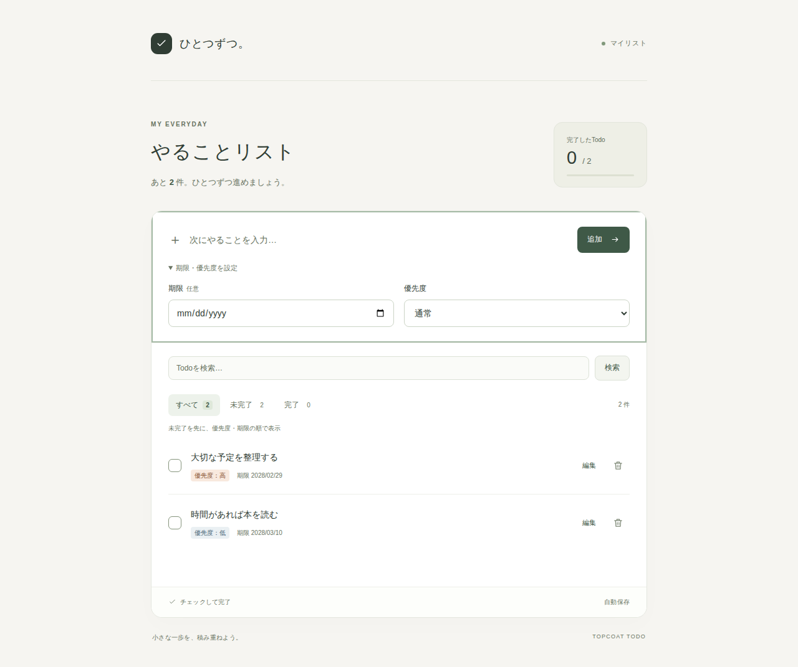

# ひとつずつ。 — Topcoat Todo Classic

`v0.1.0`（`1bda6f4`）から分岐した **`feature/topcoat-enhancements`** ブランチです。

Rustの[Topcoat](https://github.com/tokio-rs/topcoat)で作った、日本語のTodoアプリです。サーバーでHTMLを描画し、SQLiteに保存します。Dockerだけで起動とテストを実行できます。

[MIT License](LICENSE) · [検証結果](VERIFICATION.md) · [スマートフォンの画面例](preview-mobile.png)



## できること

- Todoの追加、完了・未完了の切り替え、削除
- すべて／未完了／完了の絞り込みと件数表示
- SQLiteへの自動保存。Dockerの再起動後もデータを維持
- スマートフォン幅、キーボード操作、空のリスト、入力エラーに対応
- Todoの編集、期限の設定・解除、優先度（高／通常／低）
- タイトルの部分一致検索。編集・完了・削除後も検索条件を保持
- 確認画面を経由した完了済みTodoの一括削除

画面はTopcoatの `view!` と `#[component]`、リクエストは `#[page]` と `#[route]` で実装しています。フォーム送信後は303リダイレクトするため、ページを再読み込みしても同じTodoを二重登録しません。JavaScriptやNode.jsのビルドは不要です。

## Dockerで起動

Gitと、Docker Compose v2を利用できるDocker環境が必要です。macOS・WindowsではDocker Desktopを起動しておきます。

```sh
git clone --branch feature/topcoat-enhancements https://github.com/Sparklingstadt/topcoat-todo.git topcoat-todo-classic
cd topcoat-todo-classic
docker compose up --build -d app
```

ブラウザーで **[http://localhost:3001](http://localhost:3001)** を開きます。初回はイメージ取得とRustのコンパイルに数分かかります。RustやNode.jsをホスト側にインストールする必要はありません。

ポート3001が使用中の場合:

```sh
TODO_PORT=3010 docker compose up --build -d app
```

この場合は [http://localhost:3010](http://localhost:3010) を開きます。

```sh
# ログ
docker compose logs -f app

# 停止（保存データは残る）
docker compose down

# 再開
docker compose up -d app
```

保存先はDockerボリューム `topcoat-todo-classic_todo-data` 内の `/app/data/todos.sqlite3` です。`docker compose down -v` は保存データも削除するため、通常の停止では `-v` を付けません。

## 追加機能の使い方

- **編集**: 各Todoの「編集」から内容・期限・優先度を変更します。完了状態は維持し、入力エラーでは編集内容を残します。保存せず戻る場合は「キャンセル」を選びます。
- **期限・優先度**: 追加欄の「期限・優先度を設定」を開きます。期限は任意の年月日（0001〜9999年）、既定の優先度は「通常」です。編集で日付を空欄にすると期限を解除できます。
- **並び順**: 未完了を先に、優先度の高い順、期限の早い順で表示します。期限なしは同じ優先度の末尾、同じ条件なら新しいTodoが先です。
- **検索**: タイトルを文字列として部分一致検索します。英字の大文字・小文字は区別せず、`%` や `_` はワイルドカードになりません。状態タブの件数は検索条件に合う件数、上部の進捗は全件です。新規追加後は検索を解除し、新しいTodoを表示します。
- **一括削除**: 「すべて」または「完了」の一覧にある「完了済み N 件を削除」から対象を確認し、確認欄にチェックして削除します。検索中は一致したTodoだけが対象です。確認後に未完了へ戻したTodoや新たに完了したTodoは削除しません。一度に最大1,000件です。

すべて通常のHTMLフォームとTopcoatのサーバー描画で動作します。React・shadcn/ui・ブラウザー側JavaScriptは使用しません。Node.jsはPlaywrightテストにだけ使用します。

### データとDB移行

このブランチのComposeプロジェクト名は `topcoat-todo-classic`、アプリはポート3001、レポートは9324です。保存先も専用ボリュームです。

v0.1.0のSQLiteを指定して起動すると、トランザクション内で `due_date` と `priority` を追加します。既存のID・内容・完了状態は保持し、既存Todoは「期限なし・優先度通常」になります。再起動時に同じ移行を重複実行しません。既存DBを自分で切り替える場合は、停止中のコピーをバックアップとして保存してから使用してください。

## Rustを直接使う場合

RustのstableツールチェーンとCコンパイラーがあれば、Dockerを使わず起動できます。検証時のRustは1.98.1です。

```sh
PORT=3001 cargo run --locked
```

上のコマンドでは [http://127.0.0.1:3001](http://127.0.0.1:3001) で起動します。`PORT` を省略した場合の既定値は3000です。

| 環境変数 | 既定値 | 内容 |
| --- | --- | --- |
| `HOST` | `127.0.0.1` | 待ち受けアドレス。Docker内は `0.0.0.0` |
| `PORT` | `3000` | アプリの待ち受けポート |
| `TODO_DB_PATH` | `data/todos.sqlite3` | SQLiteファイル。Docker内は `/app/data/todos.sqlite3` |
| `TODO_PORT` | `3001` | Docker Composeがホストに公開するポート |
| `TODO_REPORT_PORT` | `9324` | Playwrightレポートのホストポート |

## テスト

Dockerだけで単体・E2E・画像回帰テストをまとめて実行できます。ローカルへのRust・Node.js・ブラウザーのインストールや、アプリの事前起動は不要です。シェルスクリプトはmacOS・Linux、またはWindowsのWSL/Git Bashから実行してください。

```sh
./scripts/test.sh
```

**2026-09-19の検証結果: 全86件成功。** 詳細は[検証記録](VERIFICATION.md)と[JSONの要約](verification/test-summary.json)を参照してください。

| 種類 | 件数 | 確認内容 |
| --- | ---: | --- |
| Rust単体・DBテスト | 26 | 文字数・日付・優先度・検索の検証、DB移行、編集、保存、並び順、安全な一括削除、同時書き込み |
| Playwright E2E | 34 | 17シナリオ × 2サイズ。JavaScript無効で新旧機能を実操作。XSSの実行検証だけは別コンテキストでJavaScriptを有効化 |
| Playwright画像回帰 | 26 | 13画面 × 2サイズを保存済みPNGと比較 |

同梱の画像基準は **Linux ARM64 / Chromium** 用です。AMD64など別CPUでの初回実行は基準画像がないため画像テストが失敗します。その環境での基準作成は、後述の「画像回帰テストの基準」を参照してください。単体・E2Eテストは画像基準とは独立しています。

```sh
./scripts/test.sh unit     # Rustだけ
./scripts/test.sh e2e      # ブラウザー操作だけ
./scripts/test.sh visual   # 画像比較だけ（基準画像は更新しない）
./scripts/test.sh report   # 最新のHTMLレポートを起動
```

レポートは **[http://localhost:9324](http://localhost:9324)**。実行結果と、失敗時の期待画像・実際の画像・差分画像、スクリーンショット、操作トレース、動画、サーバーログを確認できます。停止は `docker compose stop report`。

各テストは専用のRustプロセスと一時SQLiteファイルを作り、終了時に破棄します。ブラウザーテスト用コンテナは外部ネットワークを無効にし、既存アプリのポート・DBボリュームをマウントしません。起動中の個人用リストから独立して実行できます。

### 画像回帰テストの基準

空のリスト、混在一覧、未完了タブ、完了タブ、全件完了、入力エラー、長いタイトル、期限・優先度、編集、編集エラー、検索結果、検索0件、一括削除の確認を、1280×900と390×844で確認します。

- `expect(page).toHaveScreenshot()` を使用。画面全体を撮影し、アニメーションとキャレットを抑制
- Playwright **1.63.0** と公式Dockerイメージのダイジェストを固定。日本語ロケール・東京のタイムゾーン・light表示・DPR 1を固定
- 判定は `threshold: 0.1`、許容する差分画素数は **0**。フォント読み込みを待ってから比較
- 通常実行は `updateSnapshots: 'none'`。基準画像が欠けても自動作成せず失敗
- 基準画像は `tests/playwright/__screenshots__/linux-arm64/` に同梱。PNGをソースと一緒に管理

[基準PNG](tests/playwright/__screenshots__/linux-arm64/)はソースと一緒に管理します。OS・CPU・フォント・ブラウザーが変わると描画が異なるため、保存先を環境ごとに分けています。別CPUで利用する場合は、その環境で生成した基準画像も確認して追加してください。READMEの画面例もDocker内で撮影したテスト用データです。

意図したデザイン変更、または別CPU向けの基準追加時に実行します。

```sh
./scripts/test.sh update
# 変更されたPNGを目視で確認してから通常の比較を再実行
./scripts/test.sh visual
```

更新前に、差分が意図した変更かレポートで確認してください。単にテストを通すための基準更新は、意図しない見た目の変化も基準に取り込んでしまいます。

検出能力も確認しています。テスト画面の見出しだけを一時的に変更すると画像差分で失敗し、復元後に合格しました。[期待画像・実際の画像・差分画像](verification/regression-proof/README.md)を記録しています。

実装の参考: [Playwrightの画像比較](https://playwright.dev/docs/test-snapshots)、[Docker実行](https://playwright.dev/docs/docker)。

### その他のチェック

```sh
docker compose run --build --rm tools cargo fmt --check
docker compose run --build --rm tools cargo clippy --locked --all-targets -- -D warnings
```

既存のHTTPスモークテスト `tests/http-smoke.mjs` も残しています。これはNode.js 18以降が必要で、`TODO_TEST_URL`（既定 `http://127.0.0.1:3000`）で指定する起動中アプリに検証用Todoを作って削除します。通常はDBが完全に独立する上記のテストを使ってください。

## 構成

```text
src/main.rs       起動とルーター登録
src/routes.rs     ページ・フォームの処理、入力検証
src/ui.rs         Topcoatコンポーネント
src/db.rs         SQLiteへの保存、旧DBからの移行
src/model.rs      日付・優先度・検索の検証
assets/style.css  レスポンシブな画面スタイル
Dockerfile        Rustビルドと実行イメージ
compose.yaml      localhost公開と永続ボリューム
playwright.config.ts  E2E・画像比較の構成
tests/playwright/    テスト、プロセス・DBの隔離、基準画像
scripts/test.sh      Dockerだけでテストする入口
verification/        差分検出の検証証跡
```

Topcoatは `0.8.1` に固定し、Rustとテスト用Node.jsの依存関係は `Cargo.lock` と `package-lock.json` で管理します。実験段階のフレームワークなので、更新時は[公式ドキュメント](https://docs.rs/topcoat/0.8.1/topcoat/)と互換性を確認してください。

このアプリはローカルで使う個人用サンプルです。Dockerのポート公開は `127.0.0.1` に限定しています。ログイン機能はなく、同じサーバーに接続したブラウザーは同じリストを表示します。

## ライセンス

[MIT License](LICENSE)。Copyright (c) 2026 Sparklingstadt。

依存ライブラリは、それぞれのライセンスに従います。
